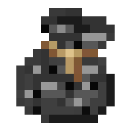

<p align="center"></p>

# BedrockBundler

> [!WARNING]
> **BedrockBundler is in beta.** It works on the setups it was tested on, but expect bugs and breaking changes
> between versions. Back up your server before trying it, and please report problems.

Makes [Nexo](https://nexomc.com/) and [ItemsAdder](https://itemsadder.devs.beer/) content visible to Bedrock
players who join through [Geyser](https://geysermc.org/).

Nexo and ItemsAdder only draw their content with a Java resource pack, so Bedrock players normally see plain paper,
note blocks and missing furniture. BedrockBundler reads the pack the plugin generates and converts it **on your
server**: there is no external conversion service and no manual pack work.

> [!NOTE]
> BedrockBundler was called **BedrockAdder** while it only supported ItemsAdder. When you update, remove the old
> `BedrockAdder-*.jar`. On first start BedrockBundler copies `plugins/BedrockAdder/config.yml`, removes Geyser's old
> `BedrockAdderExtension.jar` and keeps the extension's `config.properties`; the command is now `/bedrockbundler`
> (`/bb`) and the permission `bedrockbundler.admin`. Restart twice: once to convert, once for Geyser to load it.

## How it works

1. The content plugin builds its pack (Nexo: on start and `/nexo reload`; ItemsAdder: `/iazip`). BedrockBundler
   reads the pack and a snapshot of the plugin's item and block registry, and converts them off the main thread.
2. The result is a *bundle*: a Bedrock resource pack (`.mcpack`) plus custom item and block definitions.
3. The BedrockBundler **Geyser extension** registers the items, blocks and pack when Geyser starts. On a
   Geyser-Spigot server the extension installs itself.
4. While the server runs, BedrockBundler shows furniture (item displays) to Bedrock players.

Geyser only loads custom content when it starts, so **restart after each conversion**.

## Features

### Done

- [x] 2D items (`item/generated`, `item/handheld`)
- [x] 3D items: Bedrock geometry and attachables (first and third person, swing animation), rendered inventory icons
- [x] Items using `item_model` (1.21.4+) and legacy CustomModelData
- [x] Custom blocks on note block, mushroom, chorus and tripwire states: full cubes and custom geometry, light, hardness
- [x] Armor from 1.21.4+ `equipment` assets: player armor, elytra, and armor held in the hand
- [x] Animal armor: horse armor, wolf armor and llama carpets
- [x] Shields with a blocking model: first and third person poses that follow Java's
- [x] Tridents: Java's charge pose in first and third person; thrown custom tridents keep their flight angle
- [x] Food, max stack size, durability and equippable item properties
- [x] Furniture (`item_display`): position, rotation and scale follow the Java entity
- [x] Font images (emojis, chat icons), sized by their Java `height`/`ascent`
- [x] Positive font offsets (shift characters keep their width)
- [x] GUI backgrounds (textured inventories such as `/ia`) on the classic chest screen
- [x] ItemsAdder's pack protection: overlays, `ia:N` sprite aliases, protected PNGs and zips
- [x] Same-server Geyser-Spigot, and proxy/standalone Geyser through a shared folder or HTTP
- [x] Custom blocks also exported as Geyser JSON block mappings, for Geyser installs that use plain `custom_mappings`
- [x] Nexo 1.2x-1.30: items, note/string/chorus blocks, furniture (including evolving crops), armor, 3D hats, glyphs
- [x] Folia and Folia forks (Canvas): region-safe furniture mirrors and scheduling
- [x] Offline converter (`BedrockBundler-cli.jar`) for a Nexo folder, without a running server
- [x] Skips unchanged conversions; warnings are written to `plugins/BedrockBundler/warnings.txt`

### Planned

- [ ] Custom sounds
- [ ] ItemsAdder custom entities (mobs)
- [ ] GUI backgrounds on the pocket (touch) UI layout
- [ ] Furniture types other than `item_display` (armor stands, item frames)
- [ ] Dyeable items and furniture colors
- [ ] Legacy shader armor (leather armor with shaders)
- [ ] Plugin-message sync for proxies (no shared folder or open HTTP port needed)
- [ ] In-game command to tune 3D held-item positions

### Not possible on Bedrock

- Negative font offsets, so HUDs that are aligned with them do not look like on Java. Bedrock text cannot move backwards.
- Glyphs taller than a text line inside chat or titles. Bedrock draws every glyph at text size; GUI backgrounds are handled separately.
- More than one look for worn elytras. Bedrock players can only glide with the vanilla elytra, so Geyser sends that
  in place of a custom one. BedrockBundler gives the vanilla elytra the look of the first custom elytra; any others
  look the same while worn.

### Good to know

- Bedrock only draws armor on horses and llamas whose client entity allows it. When the pack contains armor for
  them, it replaces the vanilla horse, llama and trader llama client entities with copies that do (taken from
  Bedrock 1.26). Much older Bedrock clients may draw these animals wrongly.

## Comparison

How BedrockBundler compares with other ways of getting custom content onto Geyser. The details come from each
project's public documentation or source as of October 2026, so they may be out of date. `?` means the
documentation does not say; `—` means the row does not apply.

| | **BedrockBundler** | **Nexo Scaffolding** | **GeyserMC Rainbow** | **Chest-GUI-Generator** | **ItemsAdder alone** |
|---|---|---|---|---|---|
| Works with | ItemsAdder, Nexo | Nexo | Any server (client mod) | Any Java chest GUI pack | — |
| How you run it | Server plugin + Geyser extension | Server plugin + optional Geyser extension | Fabric client mod | Browser tool | — |
| Where conversion runs | Locally, on your server | Hosted converter (self-hosted converter jar optional) | On your client | In your browser | — |
| Automatic on pack rebuild | ✅ | ✅ | ❌ | ❌ | — |
| Items (2D / 3D) | ✅ / ✅ | ✅ / ✅ | ✅ / ? | ❌ | ❌ |
| Custom blocks | ✅ | ✅ | ❌ | ❌ | ❌ |
| Armor | ✅ | ✅ | ? | ❌ | ❌ |
| Furniture | ✅ (`item_display`) | ✅ (with extension) | ❌ | ❌ | ❌ |
| Font images / emojis | ✅ | ✅ | ❌ | ❌ | ❌ |
| GUI backgrounds | ✅ (classic UI) | ✅ | ❌ | ✅ | ❌ |
| Sounds | ❌ (planned) | ✅ | ❌ | ❌ | ❌ |
| Custom mobs / ModelEngine | ❌ (planned) | ✅ (with extension) | ❌ | ❌ | ❌ |
| Proxy / standalone Geyser | ✅ (folder, HTTP) | ✅ (plugin message, folder) | — | — | — |
| Cost | Free | Sold on [nexomc.com](https://nexomc.com/products/scaffolding) | Free | Free | — |
| Status | Beta | Early access | — | — | — |

## Requirements

| | Version |
|---|---|
| Server | Paper 1.21.4+ or a fork (Purpur, Leaf, ...) |
| Java | 21+ |
| ItemsAdder | 4.0.x (tested with 4.0.18), or |
| Nexo | 1.29+ (built against the 1.29.1 API, read against 1.30-dev) |
| Geyser | 2.11.0+ (tested with 2.12.0) |
| Floodgate | Recommended; required for furniture when Geyser runs on a proxy |

Tested on Leaf 1.21.11 with Geyser-Spigot 2.12, Floodgate and ViaVersion, and on Paper 26.2.

## Installation

### Geyser-Spigot on the same server (default)

1. Put `BedrockBundler.jar` in `plugins/` next to ItemsAdder and Geyser-Spigot.
2. Make sure `enable-custom-content: true` is set in `plugins/Geyser-Spigot/config.yml`.
3. Start the server. BedrockBundler installs its extension into `plugins/Geyser-Spigot/extensions/`.
4. Run `/iazip`, or wait for ItemsAdder to build its pack, then **restart**.

### Geyser on a proxy or standalone

1. Install BedrockBundler on the backend that runs ItemsAdder. Copy `BedrockBundlerExtension.jar` into the
   `extensions/` folder of the proxy or standalone Geyser.
2. Pick a sync type in `plugins/BedrockBundler/config.yml`:
   - `FOLDER`: a folder both machines can reach. On the Geyser side, set `source=FOLDER` and the same `folder`
     in `extensions/bedrockbundler/config.properties`.
   - `HTTP`: the plugin serves the bundle on `sync.http.port`. On the Geyser side, set `source=HTTP`,
     `url=http://<backend>:<port>/bedrockbundler/bundle` and `token=<sync.http.token>`.
3. Restart Geyser after each conversion.

> [!TIP]
> If your server runs with a Turkish system language, start Java with `-Duser.language=en -Duser.country=US`.
> Otherwise ItemsAdder turns `item_display` into `İTEM_DİSPLAY` and fails to build its pack.

### Nexo

Install BedrockBundler next to Nexo; it is picked automatically (`source: AUTO`). BedrockBundler converts once Nexo has
loaded its items and after every pack build (`/nexo reload`), reading the pack from Nexo's
`Pack.generation.output_path` (default `plugins/Nexo/pack/pack.zip`). Item models, block states and furniture come from
Nexo's API, so obfuscated packs and Nexo's own block state encoding work unchanged. Nexo furniture uses
`display_transform: NONE`, which BedrockBundler follows for the furniture pose. Thrown custom tridents use the
`display_transform` of their trident mechanic.

### Offline converter

`cli/build/libs/BedrockBundler-cli-<version>.jar` converts a Nexo folder without a server, for example for a
Geyser-Standalone that loads plain mappings:

```
java -jar BedrockBundler-cli.jar --nexo plugins/Nexo --out build/bedrock \
     [--pack plugins/Nexo/pack/pack.zip] [--geyser /path/to/geyser] [--pack-name MyPack] [--prefix mypack]
```

With `--pack` it converts Nexo's generated pack. Without it, it assembles the pack from `pack/assets` and
`pack/external_packs` and adds what Nexo would generate for blocks (block state variants from `custom_variation`) and
glyphs (font providers). `--geyser` writes `packs/<pack-name>.mcpack`, `custom_mappings/<prefix>_items.json` and
`custom_mappings/<prefix>_blocks.json`. Furniture still needs the plugin on the server (or another way to render item
displays on Bedrock).

Use the JSON mappings (from the CLI or `geyser_mappings.json` / `geyser_block_mappings.json` in the bundle) only on a
Geyser without the BedrockBundler extension. With both, Geyser registers every item and block twice.

## Configuration

`plugins/BedrockBundler/config.yml`:

| Key | Default | Meaning |
|---|---|---|
| `source` | `AUTO` | `AUTO` (Nexo if installed, else ItemsAdder), `NEXO` or `ITEMSADDER` |
| `auto-convert` | `true` | Convert whenever the content plugin builds its pack |
| `pack-name` | `BedrockBundler` | Name of the Bedrock pack; changing it makes players download it again |
| `icon-size` | `64` | Size of rendered icons for 3D items |
| `fonts.enabled` | `true` | Convert font images and GUI backgrounds |
| `fonts.cell-size` | `32` | Java font pixels per Bedrock glyph cell; raise it if emojis look too big |
| `fonts.gui-offset-x` | `-16` | Horizontal position of GUI backgrounds (ItemsAdder's `x_position_pixels`) |
| `furniture.enabled` | `true` | Show furniture to Bedrock players |
| `furniture.yaw-offset` / `y-offset` | `0` | Fine-tuning if furniture looks turned or shifted |
| `sync.type` | `AUTO` | `AUTO`, `LOCAL`, `FOLDER`, `HTTP` or `OFF` |

## Commands

| Command | Description |
|---|---|
| `/bedrockbundler reload [-f]` (`/bb`) | Convert from the content plugin's generated pack; `-f` converts even when nothing changed |
| `/bedrockbundler status` | Last conversion, deploy target, and whether Geyser needs a restart |

Permission: `bedrockbundler.admin` (op by default).

## Building from source

ItemsAdder is a paid plugin and is not on any public repository. Its hook (`paper/src/itemsadder/java`) is only
compiled when your licensed jar is at `libs/ItemsAdder-<version>.jar`; the folder is git-ignored and must never be
committed. Without it the plugin builds with Nexo support only (the Nexo API comes from `repo.nexomc.com`). Run:

```
./gradlew build
```

This builds three jars:

- `paper/build/libs/BedrockBundler-<version>.jar`: the server plugin, with the Geyser extension inside.
- `geyser-extension/build/libs/BedrockBundlerExtension-<version>.jar`: needed only for proxy or standalone Geyser.
- `cli/build/libs/BedrockBundler-cli-<version>.jar`: the offline converter.

| Module | Contents |
|---|---|
| `common` | The converter: Java pack reader, model resolver, Bedrock pack writer, specs. No Bukkit or Geyser dependency. |
| `paper` | Bukkit plugin: content sources (Nexo, ItemsAdder), conversion service, deployers, furniture mirrors |
| `geyser-extension` | Geyser extension: registers items, blocks and the pack |
| `cli` | Offline converter for a Nexo folder |

## License

BedrockBundler is licensed under the [GNU Affero General Public License v3.0](LICENSE) (AGPL-3.0-only).

Copyright (C) 2026 Altuğ

This program is free software: you can redistribute it and/or modify it under the terms of the GNU Affero
General Public License as published by the Free Software Foundation, version 3. It is distributed in the hope
that it will be useful, but WITHOUT ANY WARRANTY; without even the implied warranty of MERCHANTABILITY or
FITNESS FOR A PARTICULAR PURPOSE. See the [LICENSE](LICENSE) file for details.

If you run a modified version of BedrockBundler on a server that players connect to, the AGPL requires you to
offer those players the source code of your modified version.

ItemsAdder and Nexo are separate, paid products of their own authors. They are not included in this repository
and are not covered by this license.

## Credits

- The title-glyph test that shows GUI backgrounds on Bedrock follows
  [Chest-GUI-Generator](https://github.com/wlsgunzz/Chest-GUI-Generator).
- [GeyserMC](https://geysermc.org/) for the custom item, block and resource pack APIs.
